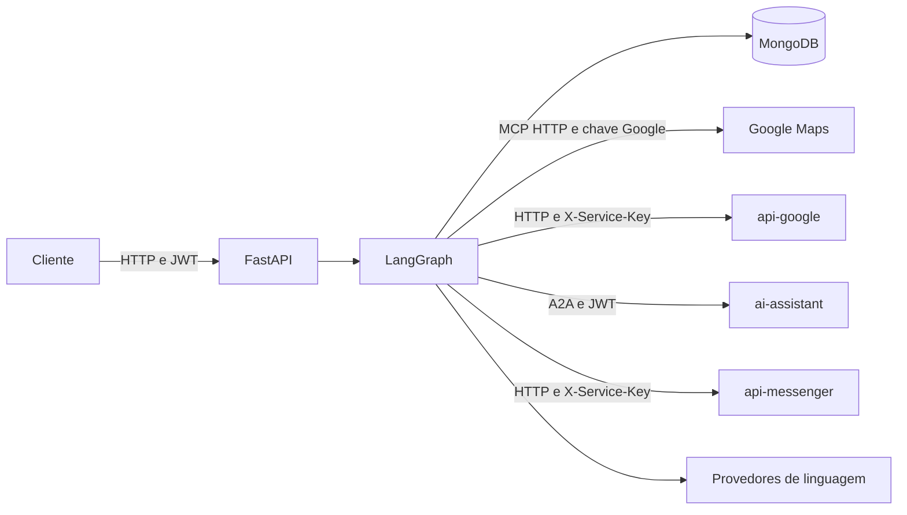
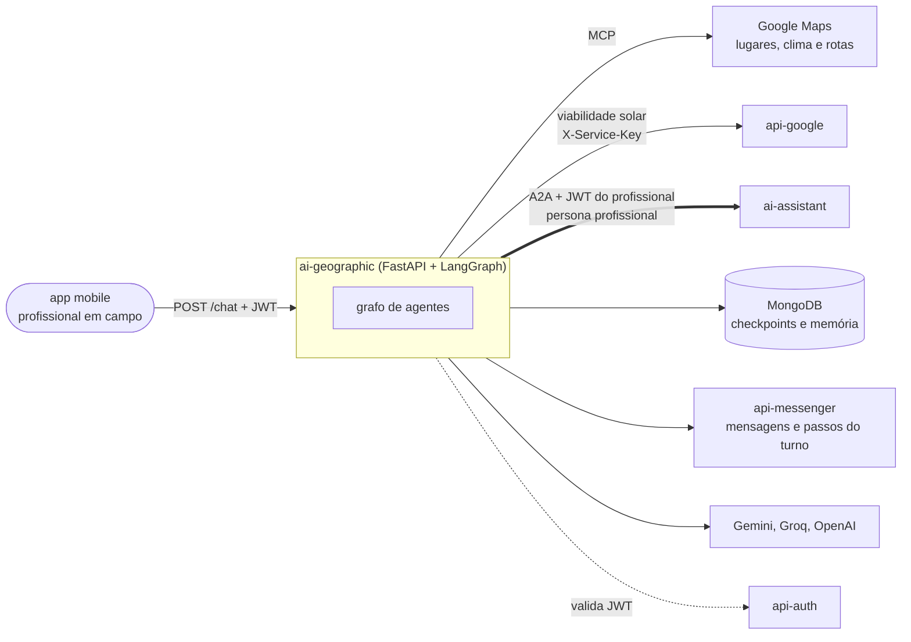
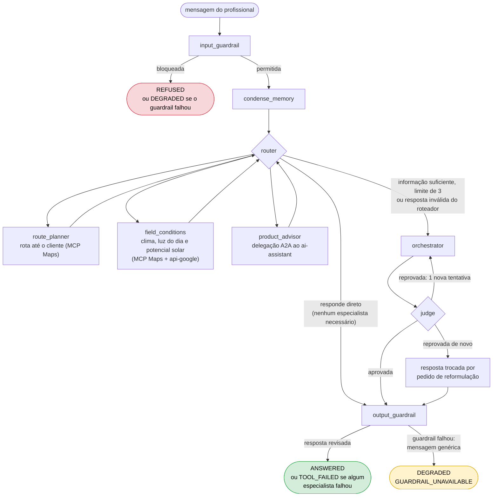
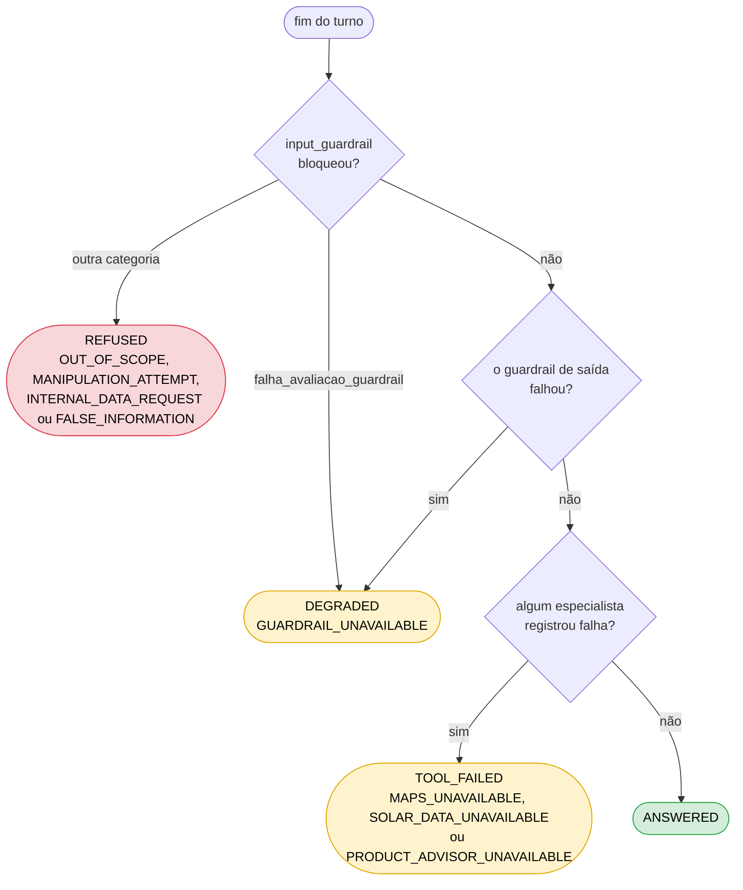

  

# Arquitetura

A API FastAPI executa um grafo LangGraph com guardrails, resumo, roteamento, especialistas, orquestração e revisão. A fonte principal é o [grafo](https://github.com/Solierrr/ai-geographic/blob/main/src/workflow/graph/graph.py).

As rotas e os schemas ficam em `src/api/`, o grafo e os seus nós em `src/workflow/` e os prompts em `src/agents/`. Os clientes externos e a persistência ficam em `src/infra/`, enquanto as configurações e a validação do JWT ficam em `src/core/`.

| Integração | Protocolo e autenticação |
|---|---|
| Cliente para `/chat` | HTTP com Bearer JWT validado pelo JWKS do `api-auth` |
| Google Maps | MCP `streamable_http`, configurado em `MAPS_MCP_URL` |
| `api-google` | HTTP com `X-Service-Key` e suporte ao token legado configurado |
| `ai-assistant` | A2A com JWT do profissional e persona `profissional` |
| `api-messenger` | Rotas internas HTTP com `X-Service-Key` |

O especialista de produtos usa a biblioteca A2A para delegar ao assistente principal, mas este serviço não publica um Agent Card próprio. Os detalhes da memória estão em [MONGO.md](../database/MONGO.md), e as integrações seguem o [mapa central](https://github.com/Solierrr/docs-warehouse/blob/main/docs/flows/INTEGRATIONS.md).

O `/health` informa se o processo está no ar e a versão lida de `version.txt`, enquanto o `/ready` testa o Mongo com limite de dois segundos e deixa os modelos de linguagem de fora, porque eles têm alternativa em caso de falha. A instrumentação OpenTelemetry é iniciada pela aplicação e pode ser desligada com `OTEL_SDK_DISABLED`.

## Diagrama de arquitetura

### Onde o serviço se encaixa

O `ai-geographic` atende o profissional em campo pelo app mobile. Lugares, clima e rotas vêm do MCP do Google Maps; o potencial solar vem do `api-google`; dúvidas de produto são delegadas por A2A ao `ai-assistant`, repassando o JWT do profissional. O serviço só consome A2A: não publica Agent Card, porque nenhum agente delega a ele.

### Grafo de um turno

Como no `ai-assistant`, cada especialista devolve o resultado ao roteador, que escolhe o próximo (até 3 por pedido) ou chama o orquestrador. Falhas de ferramenta não interrompem o turno: o especialista registra o problema e o turno segue, terminando com `outcome = TOOL_FAILED` e o motivo (`MAPS_UNAVAILABLE`, `SOLAR_DATA_UNAVAILABLE`, `PRODUCT_ADVISOR_UNAVAILABLE`), não erro HTTP.

### Como o resultado do turno é decidido

O `/chat` responde 200 e informa o desfecho em `outcome` e `reason` (`src/workflow/outcome.py`). A ordem de decisão é esta:

